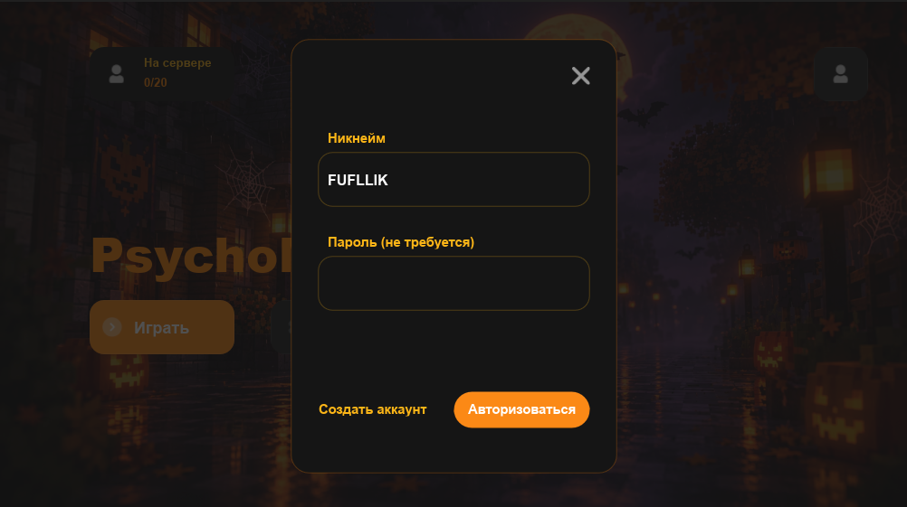

# PsychoMagic

**PsychoMagic** — лаунчер для Minecraft, созданный для удобного запуска и обновления сборки.

## 📸 Скриншоты

  

  

## 🎮 Возможности

- Быстрый запуск Minecraft
- Автоматическое обновление сборки
- Проверка состояния сервера
- Удобный интерфейс
- Автоматическая загрузка необходимых файлов
- Управление файлами сборки

## 🚀 Как пользоваться

1. Запустите **PsychoMagic**.
2. Дождитесь проверки обновлений.
3. Если доступно обновление — лаунчер установит необходимые файлы.
4. Нажмите **Играть**.
5. Дождитесь запуска Minecraft.

После установки лаунчер будет самостоятельно проверять наличие новых обновлений.

## 💻 Системные требования

- Windows 10 / 11
- Интернет-соединение
- Установленная сборка Minecraft

## 📥 Скачать

Последнюю версию PsychoMagic можно скачать в разделе **Releases** этого репозитория.

## ⚠️ Важно

PsychoMagic находится в разработке. Возможны ошибки и изменения в работе лаунчера.

---

  <b>PsychoMagic</b> 
  Ваш Minecraft. Ваш сервер. Ваш лаунчер.

